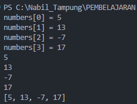

# JOBSHEET 9 - ONE-DIMENSIONAL ARRAYS

**Student Identity:**

- **Name:** Nabil
- **Student ID:** 264107020208
- **Class / Attendance No.:** TI-1I / 18

---

## 1: OBJECTIVES

The objectives of this practicum are as follows:

1. Students are able to explain how to declare, initialize, and access the elements of a one-dimensional array in Java.
2. Students are able to write programs that store and process data in one-dimensional arrays with `for` and `foreach` loops.
3. Students are able to apply arithmetic operations to array elements: total, average, highest value, and lowest value.
4. Students are able to apply simple searching (linear search) and sorting (bubble sort) to one-dimensional arrays.
5. Students are able to solve case studies from campus life with one-dimensional arrays.

---

## 2: EXPERIMENT RESULTS & ANALYSIS

### 2.1 Experiment 1: Declaring, Initializing, Filling, and Displaying Array Elements

The program creates an `int` array with a capacity of 4, assigns a value to each element by index, and displays the array in three ways: a `for` loop, a `foreach` loop, and `Arrays.toString()`. Until the assignments run, every element holds the default value 0. The loop condition uses `numbers.length` instead of the literal 4, so the loop follows the array size.

#### 2.1.1 Java Program Code

File: `3.1 Experiment 1/NumberArray18.java`

```java
import java.util.Arrays;

public class NumberArray18 {
    public static void main(String[] args) {
        int[] numbers = new int[4];

        numbers[0] = 5;
        numbers[1] = 13;
        numbers[2] = -7;
        numbers[3] = 17;

        // Display with a for loop
        for (int i = 0; i < numbers.length; i++) {
            System.out.println("numbers[" + i + "] = " + numbers[i]);
        }

        // Display with a foreach loop
        for (int number : numbers) {
            System.out.println(number);
        }

        // Display with Arrays.toString()
        System.out.println(Arrays.toString(numbers));
    }
}
```

#### 2.1.2 Running Results / Output

Output of the program:


#### 2.1.3 Answers to Questions

- **Question 1:** If the elements of the `numbers` array are changed to 5.0, 12867, 7.5, 2000000, what happens? Why does this happen?
  * **Answer:** The program does not compile. The array has type `int[]`, and `5.0` and `7.5` are `double` literals. Java refuses to narrow a `double` to an `int` automatically because the decimal part would be lost, so the compiler reports `incompatible types: possible lossy conversion from double to int` on the two lines that assign a decimal value. The values `12867` and `2000000` fit in an `int` and cause no error. Two fixes exist: declare the array as `double[]`, which accepts all four values, or keep `int[]` and use whole numbers. The error appears at compile time, so the program never runs. See section 2.1.4.
- **Question 2:** Modify the program so that the array elements are initialized at the same time the array is declared.
  * **Answer:** See section 2.1.4. The statement `int[] numbers = {5, 13, -7, 17};` replaces `new int[4]` and the four assignment lines. Java counts the values and sets the array size to 4. The output stays identical to the original program.
- **Question 3:** Change the display statement in step 4 and explain the output and the meaning of the statement.
  * **Answer:** Each line now shows the index, the element, and the element multiplied by 2 (see section 2.1.4). The statement joins text and numbers with `+`: it prints `numbers[`, the index `i`, `] = `, the element `numbers[i]`, `, doubled = `, and the result of `numbers[i] * 2`. The parentheses around the multiplication group it for readability, since `*` already binds tighter than `+`. The array itself does not change. The multiplication produces a temporary value that exists only in the printed line.
- **Question 4:** If the condition in the `for` loop is changed to `i <= 4`, what is the output? Why?
  * **Answer:** The program prints the four valid elements, then stops with `ArrayIndexOutOfBoundsException: Index 4 out of bounds for length 4`. With `i <= 4`, the fifth pass reads `numbers[4]`, but the valid indexes run from 0 to 3. The compiler does not check index values, so the program compiles and fails while it runs. The condition `i < numbers.length` stops one position before the length and avoids the error.
- **Question 5:** What is the difference between displaying an array with a `for` loop, a `foreach` loop, and `Arrays.toString()`? When should each be used?
  * **Answer:** A `for` loop gives access to the index, so it can read and modify elements, number the output lines, and compare neighbors such as `arr[i]` and `arr[i+1]`. Use it when the position matters. A `foreach` loop hands over each value and has no index. It is shorter for reading or printing, and it cannot change the array because the loop variable is a copy of the element. `Arrays.toString()` prints the whole array on one line as `[5, 13, -7, 17]` without a loop. It needs `import java.util.Arrays` and has a fixed format, which suits quick checks while debugging.

#### 2.1.4 Modified Program Code (Questions 1 to 4)

**Question 1:** Declaring `numbers` as `int[]` and assigning decimal values:

```java
int[] numbers = new int[4];

numbers[0] = 5.0;
numbers[1] = 12867;
numbers[2] = 7.5;
numbers[3] = 2000000;
```

```
NumberArray18.java:5: error: incompatible types: possible lossy conversion from double to int
        numbers[0] = 5.0;
                     ^
NumberArray18.java:7: error: incompatible types: possible lossy conversion from double to int
        numbers[2] = 7.5;
                     ^
2 errors
```

Fix: declare `double[] numbers = new double[4];` and the program prints:

```
[5.0, 12867.0, 7.5, 2000000.0]
```

**Question 2:** File: `3.1 Experiment 1/NumberArrayModified18.java`

```java
import java.util.Arrays;

public class NumberArrayModified18 {
    public static void main(String[] args) {
        // Question 2: declare and initialize the array in one statement
        int[] numbers = {5, 13, -7, 17};

        for (int i = 0; i < numbers.length; i++) {
            System.out.println("numbers[" + i + "] = " + numbers[i]);
        }

        for (int number : numbers) {
            System.out.println(number);
        }

        System.out.println(Arrays.toString(numbers));
    }
}
```

```
numbers[0] = 5
numbers[1] = 13
numbers[2] = -7
numbers[3] = 17
5
13
-7
17
[5, 13, -7, 17]
```

**Question 3:** File: `3.1 Experiment 1/NumberArrayDoubled18.java`

```java
public class NumberArrayDoubled18 {
    public static void main(String[] args) {
        int[] numbers = {5, 13, -7, 17};

        // Question 3: show each element together with its doubled value
        for (int i = 0; i < numbers.length; i++) {
            System.out.println("numbers[" + i + "] = " + numbers[i] + ", doubled = " + (numbers[i] * 2));
        }
    }
}
```

```
numbers[0] = 5, doubled = 10
numbers[1] = 13, doubled = 26
numbers[2] = -7, doubled = -14
numbers[3] = 17, doubled = 34
```

**Question 4:** Changing only the loop condition to `i <= 4`:

```java
for (int i = 0; i <= 4; i++) {
    System.out.println("numbers[" + i + "] = " + numbers[i]);
}
```

```
numbers[0] = 5
numbers[1] = 13
numbers[2] = -7
numbers[3] = 17
Exception in thread "main" java.lang.ArrayIndexOutOfBoundsException: Index 4 out of bounds for length 4
	at NumberArray18.main(NumberArray18.java:6)
```

---

### 2.2 Experiment 2: SIAKAD Case Study, Entering Student Scores and Pass/Fail Status

A lecturer enters the final scores of 10 students, and the program prints each score with a status: PASS when the score is above 70 and FAIL otherwise. One `for` loop fills the `finalScores` array and a second `for` loop prints it. The ternary operator `(finalScores[i] > 70) ? "PASS" : "FAIL"` selects the status in one line.

#### 2.2.1 Java Program Code

File: `3.2 Experiment 2/ScoreArray18.java`

```java
import java.util.Scanner;

public class ScoreArray18 {
    public static void main(String[] args) {
        int[] finalScores = new int[10];
        Scanner input = new Scanner(System.in);

        for (int i = 0; i < finalScores.length; i++) {
            System.out.print("Enter the score for student #" + (i + 1) + ": ");
            finalScores[i] = input.nextInt();
        }

        for (int i = 0; i < finalScores.length; i++) {
            String status = (finalScores[i] > 70) ? "PASS" : "FAIL";
            System.out.println("Student #" + (i + 1) + ": " + finalScores[i] + " (" + status + ")");
        }

        input.close();
    }
}
```

#### 2.2.2 Running Results / Output

Input and output of the program, using the sample scores from the jobsheet:

```
Enter the score for student #1: 85
Enter the score for student #2: 60
Enter the score for student #3: 72
Enter the score for student #4: 90
Enter the score for student #5: 45
Enter the score for student #6: 78
Enter the score for student #7: 66
Enter the score for student #8: 95
Enter the score for student #9: 50
Enter the score for student #10: 71
Student #1: 85 (PASS)
Student #2: 60 (FAIL)
Student #3: 72 (PASS)
Student #4: 90 (PASS)
Student #5: 45 (FAIL)
Student #6: 78 (PASS)
Student #7: 66 (FAIL)
Student #8: 95 (PASS)
Student #9: 50 (FAIL)
Student #10: 71 (PASS)
```

The result matches the reference output in the jobsheet.

#### 2.2.3 Answers to Questions

- **Question 1:** What does the condition `i < finalScores.length` in the loop mean?
  * **Answer:** The loop runs while `i` is smaller than the number of elements in the array. `finalScores.length` is 10, so `i` takes the values 0 to 9 and the loop stops when `i` reaches 10. The `<` operator matters because the last valid index is `length - 1`. Using `.length` instead of the literal 10 keeps the loop correct when the array size changes.
- **Question 2:** Modify the program so that it displays only the scores of students who passed. Explain the flow of the program.
  * **Answer:** See section 2.2.4. The flow has six steps. (1) The program reads ten scores into the array. (2) The display loop starts at `i = 0`. (3) The test `finalScores[i] > 70` checks the score. (4) A passing score prints a line, and a failing score prints nothing. (5) `i` increases and the loop repeats until `i` reaches 10. (6) The program prints the totals. The student number `(i + 1)` follows the array position, so the output skips numbers: students 2, 5, 7, and 9 failed and do not appear.
- **Question 3:** Change the loops in steps 4 and 5 to `foreach` loops. Can every part be converted?
  * **Answer:** The display loop in step 5 converts to `foreach` and produces the same output (see section 2.2.4). The input loop in step 4 cannot convert. In `for (int score : finalScores)`, the variable `score` holds a copy of each element, so `score = input.nextInt()` changes the copy and leaves the array at 0. Filling an array needs the index, as in `finalScores[i] = input.nextInt()`. The display loop also loses its index in `foreach`, so a manual counter `number` supplies the student number.
- **Question 4:** Modify the program so that it also displays the number of students who passed and failed.
  * **Answer:** See section 2.2.4. The counters `passCount` and `failCount` start at 0 and increase inside the loop. With the sample data, 6 students pass (85, 72, 90, 78, 95, 71) and 4 students fail (60, 45, 66, 50). The two counters add up to 10, the length of the array.

#### 2.2.4 Modified Program Code (Questions 2 to 4)

**Questions 2 and 4:** File: `3.2 Experiment 2/ScoreArrayModified18.java`

```java
import java.util.Scanner;

public class ScoreArrayModified18 {
    public static void main(String[] args) {
        int[] finalScores = new int[10];
        Scanner input = new Scanner(System.in);

        for (int i = 0; i < finalScores.length; i++) {
            System.out.print("Enter the score for student #" + (i + 1) + ": ");
            finalScores[i] = input.nextInt();
        }

        int passCount = 0;
        int failCount = 0;

        // Questions 2 and 4: print only the students who passed, count both groups
        for (int i = 0; i < finalScores.length; i++) {
            if (finalScores[i] > 70) {
                System.out.println("Student #" + (i + 1) + ": " + finalScores[i] + " (PASS)");
                passCount++;
            } else {
                failCount++;
            }
        }

        System.out.println("Students who passed: " + passCount);
        System.out.println("Students who failed: " + failCount);
        input.close();
    }
}
```

```
Enter the score for student #1: 85
Enter the score for student #2: 60
Enter the score for student #3: 72
Enter the score for student #4: 90
Enter the score for student #5: 45
Enter the score for student #6: 78
Enter the score for student #7: 66
Enter the score for student #8: 95
Enter the score for student #9: 50
Enter the score for student #10: 71
Student #1: 85 (PASS)
Student #3: 72 (PASS)
Student #4: 90 (PASS)
Student #6: 78 (PASS)
Student #8: 95 (PASS)
Student #10: 71 (PASS)
Students who passed: 6
Students who failed: 4
```

**Question 3:** File: `3.2 Experiment 2/ScoreArrayForeach18.java`

```java
import java.util.Scanner;

public class ScoreArrayForeach18 {
    public static void main(String[] args) {
        int[] finalScores = new int[10];
        Scanner input = new Scanner(System.in);

        // Question 3: this loop must stay a for loop because it assigns to finalScores[i]
        for (int i = 0; i < finalScores.length; i++) {
            System.out.print("Enter the score for student #" + (i + 1) + ": ");
            finalScores[i] = input.nextInt();
        }

        // This loop only reads the elements, so foreach works.
        // foreach has no index, so a manual counter numbers the students.
        int number = 1;
        for (int score : finalScores) {
            String status = (score > 70) ? "PASS" : "FAIL";
            System.out.println("Student #" + number + ": " + score + " (" + status + ")");
            number++;
        }

        input.close();
    }
}
```

```
Enter the score for student #1: 85
Enter the score for student #2: 60
Enter the score for student #3: 72
Enter the score for student #4: 90
Enter the score for student #5: 45
Enter the score for student #6: 78
Enter the score for student #7: 66
Enter the score for student #8: 95
Enter the score for student #9: 50
Enter the score for student #10: 71
Student #1: 85 (PASS)
Student #2: 60 (FAIL)
Student #3: 72 (PASS)
Student #4: 90 (PASS)
Student #5: 45 (FAIL)
Student #6: 78 (PASS)
Student #7: 66 (FAIL)
Student #8: 95 (PASS)
Student #9: 50 (FAIL)
Student #10: 71 (PASS)
```

---

### 2.3 Experiment 3: Arithmetic Operations on Arrays, Total, Average, Highest and Lowest Scores

This experiment continues the SIAKAD case study and produces a recap of 10 scores: total, average, highest score, lowest score, and a class grade. The loop that reads each score also adds it to `total`, so one pass handles both jobs. `highest` and `lowest` start at `studentScores[0]`, and the second loop starts at index 1 because index 0 is already the starting value. An `if / else if` chain on the average sets the class grade: 85 and above is EXCELLENT, 70 and above is GOOD, and anything lower is NEEDS IMPROVEMENT.

#### 2.3.1 Java Program Code

File: `3.3 Experiment 3/AverageScoreArray18.java`

```java
import java.util.Scanner;

public class AverageScoreArray18 {
    public static void main(String[] args) {
        Scanner input = new Scanner(System.in);

        int[] studentScores = new int[10];
        int total = 0;
        double average;

        for (int i = 0; i < studentScores.length; i++) {
            System.out.print("Enter the score for student #" + (i + 1) + ": ");
            studentScores[i] = input.nextInt();
            total += studentScores[i];
        }

        average = (double) total / studentScores.length;
        System.out.println("Total score: " + total);
        System.out.println("Average: " + average);

        int highest = studentScores[0];
        int lowest = studentScores[0];
        for (int i = 1; i < studentScores.length; i++) {
            if (studentScores[i] > highest) highest = studentScores[i];
            if (studentScores[i] < lowest) lowest = studentScores[i];
        }
        System.out.println("Highest score: " + highest);
        System.out.println("Lowest score: " + lowest);

        String category;
        if (average >= 85) {
            category = "EXCELLENT";
        } else if (average >= 70) {
            category = "GOOD";
        } else {
            category = "NEEDS IMPROVEMENT";
        }
        System.out.println("Class grade: " + category);

        input.close();
    }
}
```

#### 2.3.2 Running Results / Output

Input and output of the program, using the same scores as Experiment 2:

```
Enter the score for student #1: 85
Enter the score for student #2: 60
Enter the score for student #3: 72
Enter the score for student #4: 90
Enter the score for student #5: 45
Enter the score for student #6: 78
Enter the score for student #7: 66
Enter the score for student #8: 95
Enter the score for student #9: 50
Enter the score for student #10: 71
Total score: 712
Average: 71.2
Highest score: 95
Lowest score: 45
Class grade: GOOD
```

The result matches the reference output in the jobsheet. The average 71.2 falls in the range 70 to 84.99, so the class grade is GOOD.

#### 2.3.3 Answers to Questions

- **Question 1:** Modify the code so that it displays the number of students who passed (score > 70).
  * **Answer:** See section 2.3.4. The counter `passedCount` increases inside the input loop whenever `studentScores[i] > 70`. For the test data 80, 65, 90, 71, and 50, three students pass (80, 90, and 71).
- **Question 2:** Modify the program so that it accepts the number of array elements from user input.
  * **Answer:** See section 2.3.4. The program reads `n` first and then creates the array with `new int[n]`. An array keeps a fixed size after creation, but the size can come from a variable as long as the program reads it before creating the array. Every other statement uses `studentScores.length` instead of 10, so the total, average, highest value, and lowest value stay correct for any `n`. A `while` loop rejects `n < 1`, because `studentScores[0]` does not exist in an empty array and would throw an exception.
- **Question 3:** Why is `(double) total / studentScores.length` used instead of `total / studentScores.length`?
  * **Answer:** `total` and `studentScores.length` are both `int`, so `total / studentScores.length` is an integer division that drops the decimal part. With the sample data, 712 / 10 gives 71, and the program prints 71.0 instead of 71.2. The cast `(double) total` converts `total` to a `double` before the division, so Java promotes the length to `double` as well and divides as decimals: 712.0 / 10 = 71.2. The cast applies to `total` only, because a cast binds tighter than `/`. Writing `(double) (total / studentScores.length)` would still fail, since the integer division runs first inside the parentheses.

#### 2.3.4 Modified Program Code (Questions 1 and 2)

File: `3.3 Experiment 3/AverageScoreModified18.java`

```java
import java.util.Scanner;

public class AverageScoreModified18 {
    public static void main(String[] args) {
        Scanner input = new Scanner(System.in);

        // Question 2: the array size comes from the keyboard
        System.out.print("Enter the number of students: ");
        int n = input.nextInt();
        while (n < 1) {
            System.out.print("The number must be at least 1. Try again: ");
            n = input.nextInt();
        }

        int[] studentScores = new int[n];
        int total = 0;
        int passedCount = 0;

        for (int i = 0; i < studentScores.length; i++) {
            System.out.print("Enter the score for student #" + (i + 1) + ": ");
            studentScores[i] = input.nextInt();
            total += studentScores[i];
            // Question 1: count students with a score above 70
            if (studentScores[i] > 70) {
                passedCount++;
            }
        }

        double average = (double) total / studentScores.length;

        int highest = studentScores[0];
        int lowest = studentScores[0];
        for (int i = 1; i < studentScores.length; i++) {
            if (studentScores[i] > highest) highest = studentScores[i];
            if (studentScores[i] < lowest) lowest = studentScores[i];
        }

        System.out.println("Total score: " + total);
        System.out.println("Average: " + average);
        System.out.println("Highest score: " + highest);
        System.out.println("Lowest score: " + lowest);
        System.out.println("Students who passed (> 70): " + passedCount);

        input.close();
    }
}
```

Test run with an invalid size (0) followed by 5 students:

```
Enter the number of students: 0
The number must be at least 1. Try again: 5
Enter the score for student #1: 80
Enter the score for student #2: 65
Enter the score for student #3: 90
Enter the score for student #4: 71
Enter the score for student #5: 50
Total score: 356
Average: 71.2
Highest score: 90
Lowest score: 50
Students who passed (> 70): 3
```

Check: 80 + 65 + 90 + 71 + 50 = 356, and 356 / 5 = 71.2.

---

### 2.4 Experiment 4: Simple Searching and Sorting

Part A searches for a value in the `scores` array with linear search: the loop compares each element with `key` from index 0 and stops at the first match. The boolean `found` records whether the search succeeded, so the message after the loop appears only when no element matched. Part B sorts the same array in ascending order with bubble sort.

#### 2.4.1 Java Program Code, Part A (Linear Search)

File: `3.4 Experiment 4/ScoreSearch18.java`

```java
public class ScoreSearch18 {
    public static void main(String[] args) {
        int[] scores = {78, 65, 90, 55, 88, 72};
        int key = 90;
        boolean found = false;

        for (int i = 0; i < scores.length; i++) {
            if (scores[i] == key) {
                System.out.println("Score " + key + " was found at index " + i);
                found = true;
                break;
            }
        }
        if (!found) {
            System.out.println("Score " + key + " was not found.");
        }
    }
}
```

#### 2.4.2 Running Results / Output, Part A

With `key = 90`:

```
Score 90 was found at index 2
```

After changing the value to `int key = 100;`:

```
Score 100 was not found.
```

Both results match the reference output in the jobsheet.

#### 2.4.3 Java Program Code, Part B (Bubble Sort)

File: `3.4 Experiment 4/ScoreSort18.java`

```java
import java.util.Arrays;

public class ScoreSort18 {
    public static void main(String[] args) {
        int[] scores = {78, 65, 90, 55, 88, 72};

        for (int i = 0; i < scores.length - 1; i++) {
            for (int j = 0; j < scores.length - 1 - i; j++) {
                if (scores[j] > scores[j + 1]) {
                    int temp = scores[j];
                    scores[j] = scores[j + 1];
                    scores[j + 1] = temp;
                }
            }
        }
        System.out.println(Arrays.toString(scores));
    }
}
```

#### 2.4.4 Running Results / Output, Part B

```
[55, 65, 72, 78, 88, 90]
```

The array `{78, 65, 90, 55, 88, 72}` is now in ascending order, which matches the reference output in the jobsheet.

#### 2.4.5 Answers to Questions

- **Question 1:** Explain the meaning of the `break;` statement in the Part A code.
  * **Answer:** `break` ends the `for` loop immediately after the first match. Without it, the loop keeps comparing the remaining elements even though the answer is known. With unique values the output stays the same and the loop wastes comparisons. With duplicate values, for example `{78, 90, 55, 90}`, the program prints a message for every match instead of only the first. With `break`, a key at index 2 needs 3 comparisons instead of 6.
- **Question 2:** Modify the Part A code so that the program accepts the number of elements, the array contents, and the value to search for, and prints the index of that value.
  * **Answer:** See section 2.4.6. The program reads `n`, creates `new int[n]`, fills the array in a loop, reads `key`, and runs the same linear search.
- **Question 3:** Display a more informative message when the value is not found.
  * **Answer:** See section 2.4.6. The message names the searched value and prints the array with `Arrays.toString()`, so the user sees what the program compared. A second line tells the user to check the value and try again.
- **Question 4:** Explain step by step how the bubble sort algorithm in Part B works, using the test data.
  * **Answer:** The outer loop runs `length - 1 = 5` passes. In each pass, the inner loop compares the neighbors `scores[j]` and `scores[j + 1]` and swaps them when the left value is larger. The variable `temp` holds one value during the swap. The largest unsorted value moves to the end of the unsorted part, so after pass 1 the value 90 sits at index 5. The inner limit `length - 1 - i` shrinks on every pass because the last `i` positions already hold their final values. Pass 1 in detail: `j = 0` swaps 78 and 65, `j = 1` leaves 78 and 90, `j = 2` swaps 90 and 55, `j = 3` swaps 90 and 88, and `j = 4` swaps 90 and 72.

    | Pass | Swaps | Array after the pass |
    | ---- | ----- | -------------------- |
    | Start | - | [78, 65, 90, 55, 88, 72] |
    | 1 | 4 | [65, 78, 55, 88, 72, 90] |
    | 2 | 2 | [65, 55, 78, 72, 88, 90] |
    | 3 | 2 | [55, 65, 72, 78, 88, 90] |
    | 4 | 0 | [55, 65, 72, 78, 88, 90] |
    | 5 | 0 | [55, 65, 72, 78, 88, 90] |

    The array is sorted after pass 3. Passes 4 and 5 make no swap. The whole run takes 15 comparisons and 8 swaps. Two nested loops give the O(n²) cost listed in the jobsheet.
- **Question 5:** Modify the Part B program so that it sorts from the largest to the smallest value.
  * **Answer:** See section 2.4.6. Changing the comparison from `scores[j] > scores[j + 1]` to `scores[j] < scores[j + 1]` swaps a pair when the left value is smaller, so the smallest values move to the end.

#### 2.4.6 Modified Program Code (Questions 2, 3, and 5)

**Questions 2 and 3:** File: `3.4 Experiment 4/ScoreSearchInput18.java`

```java
import java.util.Arrays;
import java.util.Scanner;

public class ScoreSearchInput18 {
    public static void main(String[] args) {
        Scanner input = new Scanner(System.in);

        System.out.print("Enter the number of elements: ");
        int n = input.nextInt();
        int[] scores = new int[n];

        for (int i = 0; i < scores.length; i++) {
            System.out.print("Enter score #" + (i + 1) + ": ");
            scores[i] = input.nextInt();
        }

        System.out.print("Enter the score to search for: ");
        int key = input.nextInt();

        boolean found = false;
        for (int i = 0; i < scores.length; i++) {
            if (scores[i] == key) {
                System.out.println("Score " + key + " was found at index " + i);
                found = true;
                break;
            }
        }

        // Question 3: an informative message that shows the array that was searched
        if (!found) {
            System.out.println("Score " + key + " was not found in the array " + Arrays.toString(scores) + ".");
            System.out.println("Please check the value and try again.");
        }

        input.close();
    }
}
```

Test run with a value that exists:

```
Enter the number of elements: 6
Enter score #1: 78
Enter score #2: 65
Enter score #3: 90
Enter score #4: 55
Enter score #5: 88
Enter score #6: 72
Enter the score to search for: 55
Score 55 was found at index 3
```

Test run with a value that does not exist:

```
Enter the number of elements: 6
Enter score #1: 78
Enter score #2: 65
Enter score #3: 90
Enter score #4: 55
Enter score #5: 88
Enter score #6: 72
Enter the score to search for: 100
Score 100 was not found in the array [78, 65, 90, 55, 88, 72].
Please check the value and try again.
```

**Question 5:** File: `3.4 Experiment 4/ScoreSortDesc18.java`

```java
import java.util.Arrays;

public class ScoreSortDesc18 {
    public static void main(String[] args) {
        int[] scores = {78, 65, 90, 55, 88, 72};
        System.out.println("Before: " + Arrays.toString(scores));

        for (int i = 0; i < scores.length - 1; i++) {
            for (int j = 0; j < scores.length - 1 - i; j++) {
                // Question 5: the comparison changes from > to < for descending order
                if (scores[j] < scores[j + 1]) {
                    int temp = scores[j];
                    scores[j] = scores[j + 1];
                    scores[j + 1] = temp;
                }
            }
        }
        System.out.println("After: " + Arrays.toString(scores));
    }
}
```

```
Before: [78, 65, 90, 55, 88, 72]
After: [90, 88, 78, 72, 65, 55]
```

---

## 3: INDEPENDENT ASSIGNMENT

The following assignments were completed in this jobsheet:

- [x] **Assignment 1:** Managing student scores with total, average, highest, lowest, and PASS / FAIL status.
- [x] **Assignment 2:** Campus café ordering application with linear search, order validation, and total cost.

### 3.1 Code Implementation of Assignment 1: Managing Student Scores

The program reads the number of scores, fills an array with one score per student, and prints the average, the highest score, the lowest score, and the PASS / FAIL status of every student.

Design decisions:

- The program creates the array after it reads the number of scores, so the array has exactly one slot per student.
- A number of scores below 1 is rejected, because the highest and lowest logic reads index 0.
- A score outside 0 to 100 is rejected and requested again. The inner `while` loop keeps the same student number until the score is valid.
- PASS means a score greater than 70, as the jobsheet defines it. A score of exactly 70 receives FAIL.
- `total` grows inside the input loop, and the average uses the `(double)` cast from Experiment 3. `printf("%.2f")` prints two decimals. A computer with Indonesian regional settings prints `73,33` with a comma.
- `highest` and `lowest` use the comparison variable technique from Experiment 3.

File: `4.1 Assignment 1/ManageScores18.java`

```java
import java.util.Scanner;

public class ManageScores18 {
    public static void main(String[] args) {
        Scanner input = new Scanner(System.in);

        // Number of scores to enter
        System.out.print("Enter the number of student scores: ");
        int n = input.nextInt();
        while (n < 1) {
            System.out.print("The number must be at least 1. Try again: ");
            n = input.nextInt();
        }

        int[] scores = new int[n];
        int total = 0;

        // Enter each score, rejecting values outside 0 to 100
        for (int i = 0; i < scores.length; i++) {
            System.out.print("Enter the score for student #" + (i + 1) + ": ");
            int score = input.nextInt();
            while (score < 0 || score > 100) {
                System.out.print("The score must be between 0 and 100. Try again: ");
                score = input.nextInt();
            }
            scores[i] = score;
            total += score;
        }

        // Average
        double average = (double) total / scores.length;

        // Highest and lowest
        int highest = scores[0];
        int lowest = scores[0];
        for (int i = 1; i < scores.length; i++) {
            if (scores[i] > highest) highest = scores[i];
            if (scores[i] < lowest) lowest = scores[i];
        }

        // Report with PASS / FAIL status
        System.out.println();
        System.out.println("===== SCORE REPORT =====");
        for (int i = 0; i < scores.length; i++) {
            String status = (scores[i] > 70) ? "PASS" : "FAIL";
            System.out.println("Student #" + (i + 1) + ": " + scores[i] + " (" + status + ")");
        }
        System.out.println("------------------------");
        System.out.printf("Average : %.2f%n", average);
        System.out.println("Highest : " + highest);
        System.out.println("Lowest  : " + lowest);

        input.close();
    }
}
```

Test run with an invalid number of scores (0), an invalid score above the range (105), and an invalid negative score (-3):

```
Enter the number of student scores: 0
The number must be at least 1. Try again: 6
Enter the score for student #1: 85
Enter the score for student #2: 60
Enter the score for student #3: 72
Enter the score for student #4: 105
The score must be between 0 and 100. Try again: -3
The score must be between 0 and 100. Try again: 90
Enter the score for student #5: 45
Enter the score for student #6: 88

===== SCORE REPORT =====
Student #1: 85 (PASS)
Student #2: 60 (FAIL)
Student #3: 72 (PASS)
Student #4: 90 (PASS)
Student #5: 45 (FAIL)
Student #6: 88 (PASS)
------------------------
Average : 73.33
Highest : 90
Lowest  : 45
```

| Check | Expected | Program output |
| ----- | -------- | -------------- |
| Total | 85 + 60 + 72 + 90 + 45 + 88 = 440 | - |
| Average | 440 / 6 = 73.33 | 73.33 |
| Highest | 90 | 90 |
| Lowest | 45 | 45 |
| PASS (score > 70) | 85, 72, 90, 88 | Students #1, #3, #4, #6 |
| FAIL | 60, 45 | Students #2, #5 |

The values 105 and -3 triggered the range message and did not enter the array, so student #4 received 90.

### 3.2 Code Implementation of Assignment 2: Campus Café Ordering Application

The program shows the menu, lets the user search the menu by name, records the order, and prints an order summary with the total cost.

Design decisions:

- `menu` and `prices` are parallel arrays initialized at declaration. The same index in both arrays refers to the same item.
- `findMenu()` implements the linear search and returns the index of the item or -1. The search feature and the order validation share this method.
- `equalsIgnoreCase()` and `trim()` make the search ignore letter case and extra spaces, so `fried rice` finds `Fried Rice`.
- The search repeats until the user answers anything other than `y`.
- The `orders` array is separate from `menu` and has one slot per ordered item. A `while` loop asks for the same item number again until the name exists in the menu.
- `orderPrices` stores the price of each ordered item, so the summary does not search the menu a second time.
- Every input uses `nextLine()`, and numbers pass through `Integer.parseInt()`. This avoids the leftover newline that `nextInt()` leaves in the buffer. `readPositiveInt()` rejects text and numbers below 1.
- Each entry orders one portion. A customer who wants two portions of the same item enters the name twice, because the jobsheet defines no quantity.
- `rupiah()` formats amounts with dots as thousand separators, and `printf` column widths keep the summary aligned.

File: `4.2 Assignment 2/CafeOrder18.java`

```java
import java.util.Scanner;

public class CafeOrder18 {

    // Linear search: returns the index of the menu item, or -1 if it does not exist
    static int findMenu(String[] menu, String name) {
        for (int i = 0; i < menu.length; i++) {
            if (menu[i].equalsIgnoreCase(name.trim())) {
                return i;
            }
        }
        return -1;
    }

    // Formats an amount as Rupiah, for example 15000 -> Rp 15.000
    static String rupiah(int amount) {
        return "Rp " + String.format("%,d", amount).replace(',', '.');
    }

    // Reads a whole number of at least 1 and asks again until the input is valid
    static int readPositiveInt(Scanner input, String prompt) {
        while (true) {
            System.out.print(prompt);
            try {
                int value = Integer.parseInt(input.nextLine().trim());
                if (value >= 1) {
                    return value;
                }
            } catch (NumberFormatException e) {
                // falls through to the message below
            }
            System.out.println("Please enter a whole number of at least 1.");
        }
    }

    public static void main(String[] args) {
        String[] menu = {"Fried Rice", "Fried Noodles", "Toast", "French Fries", "Pulled Tea", "Cappuccino", "Chocolate Ice"};
        int[] prices = {15000, 13000, 10000, 12000, 8000, 18000, 20000};
        Scanner input = new Scanner(System.in);

        // Menu list
        System.out.println("===== CAMPUS CAFE MENU =====");
        for (int i = 0; i < menu.length; i++) {
            System.out.printf("%d. %-15s %s%n", i + 1, menu[i], rupiah(prices[i]));
        }

        // Menu search (linear search)
        String again;
        do {
            System.out.print("\nSearch menu name: ");
            String keyword = input.nextLine();
            int found = findMenu(menu, keyword);
            if (found >= 0) {
                System.out.println("\"" + menu[found] + "\" is available. Price: " + rupiah(prices[found]));
            } else {
                System.out.println("Sorry, \"" + keyword.trim() + "\" is not available on the menu.");
            }
            System.out.print("Search another menu? (y/n): ");
            again = input.nextLine().trim();
        } while (again.equalsIgnoreCase("y"));

        // Ordering
        System.out.println();
        int itemCount = readPositiveInt(input, "How many items do you want to order? ");

        String[] orders = new String[itemCount];   // order array, separate from the menu array
        int[] orderPrices = new int[itemCount];
        int total = 0;

        for (int i = 0; i < orders.length; i++) {
            int index = -1;
            while (index < 0) {
                System.out.print("Item #" + (i + 1) + " menu name: ");
                String name = input.nextLine();
                index = findMenu(menu, name);
                if (index < 0) {
                    System.out.println("Menu not found. Please enter a name from the menu list.");
                }
            }
            orders[i] = menu[index];
            orderPrices[i] = prices[index];
            total += prices[index];
        }

        // Order summary and total cost
        System.out.println();
        System.out.println("========== ORDER SUMMARY ==========");
        System.out.printf("%-4s%-18s%12s%n", "No", "Item", "Price");
        System.out.println("-----------------------------------");
        for (int i = 0; i < orders.length; i++) {
            System.out.printf("%-4d%-18s%12s%n", i + 1, orders[i], rupiah(orderPrices[i]));
        }
        System.out.println("-----------------------------------");
        System.out.printf("%-22s%12s%n", "TOTAL (" + orders.length + " items)", rupiah(total));
        System.out.println("===================================");

        input.close();
    }
}
```

Test run with a menu that exists in lowercase (`fried rice`), a menu that does not exist (`Pizza`), invalid order counts (`abc` and `0`), and an invalid item name (`Burger`):

```
===== CAMPUS CAFE MENU =====
1. Fried Rice      Rp 15.000
2. Fried Noodles   Rp 13.000
3. Toast           Rp 10.000
4. French Fries    Rp 12.000
5. Pulled Tea      Rp 8.000
6. Cappuccino      Rp 18.000
7. Chocolate Ice   Rp 20.000

Search menu name: fried rice
"Fried Rice" is available. Price: Rp 15.000
Search another menu? (y/n): y

Search menu name: Pizza
Sorry, "Pizza" is not available on the menu.
Search another menu? (y/n): y

Search menu name: cappuccino
"Cappuccino" is available. Price: Rp 18.000
Search another menu? (y/n): n

How many items do you want to order? abc
Please enter a whole number of at least 1.
How many items do you want to order? 0
Please enter a whole number of at least 1.
How many items do you want to order? 4
Item #1 menu name: Toast
Item #2 menu name: Burger
Menu not found. Please enter a name from the menu list.
Item #2 menu name: pulled tea
Item #3 menu name: Fried Rice
Item #4 menu name: Chocolate Ice

========== ORDER SUMMARY ==========
No  Item                     Price
-----------------------------------
1   Toast                Rp 10.000
2   Pulled Tea            Rp 8.000
3   Fried Rice           Rp 15.000
4   Chocolate Ice        Rp 20.000
-----------------------------------
TOTAL (4 items)          Rp 53.000
===================================
```

| Item | Price (Rp) |
| ---- | ---------- |
| Toast | 10,000 |
| Pulled Tea | 8,000 |
| Fried Rice | 15,000 |
| Chocolate Ice | 20,000 |
| **Total (4 items)** | **53,000** |

The invalid name `Burger` triggered the retry message and did not enter the `orders` array. The program asked for item #2 again and accepted `pulled tea`.

---

## 4: CONCLUSION

An array stores values of one type in a single variable, and the index starts at 0, so the last valid index is `length - 1`. Reading past that index compiles and then fails while the program runs, as Experiment 1 showed. A `for` loop fits any task that needs the index, such as filling an array, numbering output, or comparing neighbors. A `foreach` loop fits simple reading, and it cannot fill an array because its variable is a copy. Aggregation runs through the array once with an accumulator (`total`) or a comparison variable (`highest`, `lowest`), and the `(double)` cast keeps the average from losing its decimals. Linear search checks each element in turn and `break` stops it at the first match. Bubble sort swaps neighbors across nested loops, which costs O(n²). Both assignments combine these tools: Assignment 1 handles scores with validation and statistics, and Assignment 2 searches the menu array, validates each order against it, and sums the prices.