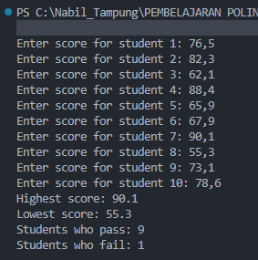
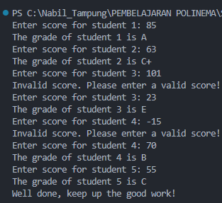
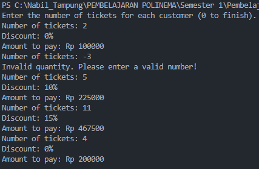
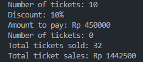
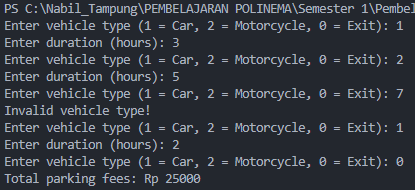

# JOBSHEET 7 - LOOPS 1

**Student Identity:**

- **Name:** Nabil
- **Student ID:** 264107020208
- **Class / Attendance No.:** TI-1I / 18

---

## 1: OBJECTIVES

The objectives of this practicum are as follows:

1. Students are able to explain the syntax for writing loop programs (`for`, `while`, and `do-while`).
2. Students are able to implement loop flowcharts using the Java programming language.

---

## 2: EXPERIMENT RESULTS & ANALYSIS

### 2.1 Experiment 1: Student Grades Case Study in SIAKAD (FOR Loop)

A lecturer enters the quiz scores of 10 students in one class. The program reads each score, then displays the highest and lowest score. A `for` loop fits this task because the number of students is fixed at 10. `highest` starts at 0 and `lowest` starts at 100. Two separate `if` statements update them on every pass.

#### 2.1.1 Java Program Code

File: `SiakadFor18.java`

```java
import java.util.Scanner;

public class SiakadFor18 {
    public static void main(String[] args) {
        Scanner sc = new Scanner(System.in);
        double score, highest = 0, lowest = 100;

        for (int i = 1; i <= 10; i++) {
            System.out.print("Enter score for student " + i + ": ");
            score = sc.nextDouble();
            if (score > highest) {
                highest = score;
            }
            if (score < lowest) {
                lowest = score;
            }
        }

        System.out.println("Highest score: " + highest);
        System.out.println("Lowest score: " + lowest);
        sc.close();
    }
}
```

#### 2.1.2 Running Results / Screenshot Output

Input and output of the program, using the ten scores from the jobsheet:

```text
Enter score for student 1: 76.5
Enter score for student 2: 82.3
Enter score for student 3: 62.1
Enter score for student 4: 88.4
Enter score for student 5: 65.9
Enter score for student 6: 67.9
Enter score for student 7: 90.1
Enter score for student 8: 55.3
Enter score for student 9: 73.7
Enter score for student 10: 78.6
Highest score: 90.1
Lowest score: 55.3
```

The result matches the figure in the jobsheet (highest 90.1, lowest 55.3).


#### 2.1.3 Answers to Questions

- **Question 1:** Identify and indicate each component of the FOR loop in the program code of Experiment 1.
  - **Answer:** The loop is `for (int i = 1; i <= 10; i++) { ... }`. It has four components. The **initialization** `int i = 1` creates the counter and runs once before the first pass. The **condition** `i <= 10` is checked before every pass, and the loop continues while it is `true`. The **update** `i++` adds 1 to the counter after each pass. The **body** `{ ... }` reads a score and updates `highest` and `lowest`. The counter starts at 1 and the condition uses `<=`, so the body runs exactly 10 times, once per student.
- **Question 2:** Why is `highest` initialized to 0 and `lowest` to 100? What happens if `highest` is initialized to 100 and `lowest` to 0?
  - **Answer:** A valid score lies between 0 and 100. Starting `highest` at the smallest possible score and `lowest` at the largest possible score means the first entry always replaces both, so any real score can take over. If `highest = 100` and `lowest = 0`, no valid score can satisfy `score > highest` or `score < lowest`. Neither variable ever changes, and the program prints `Highest score: 100.0` and `Lowest score: 0.0` for every input, which is wrong.
- **Question 3:** Explain the function and workflow of the `if (score > highest) { highest = score; }` and `if (score < lowest) { lowest = score; }` snippet.
  - **Answer:** The snippet runs once per student, right after the score is read. The first `if` compares the new score with the highest score seen so far, and a larger score becomes the new `highest`. The second `if` compares the new score with the lowest score seen so far, and a smaller score becomes the new `lowest`. The two checks are separate `if` statements, not `if / else if`. The first score (76.5) must update both variables, because it is greater than 0 and smaller than 100. With `else if`, the second check would be skipped on that pass.
- **Question 4:** Modify the program to count how many students pass and fail (minimum passing score of 60).
  - **Answer:** See section 2.1.4. Two counters, `passCount` and `failCount`, increase inside the loop according to `score >= 60`. With the sample data, 9 students pass and 1 student (55.3) fails.
- **Question 5:** Commit and push the program code to GitHub.
  - **Answer:** Done. The code is committed and pushed to the repository `programming-fundamentals-jobsheet7`.

#### 2.1.4 Modified Program Code (Question 4)

File: `SiakadForModified18.java`

````java
import java.util.Scanner;

public class SiakadForModified18 {
    public static void main(String[] args) {
        Scanner sc = new Scanner(System.in);
        double score, highest = 0, lowest = 100;
        int passCount = 0, failCount = 0;

        for (int i = 1; i <= 10; i++) {
            System.out.print("Enter score for student " + i + ": ");
            score = sc.nextDouble();
            if (score > highest) {
                highest = score;
            }
            if (score < lowest) {
                lowest = score;
            }
            // Passing threshold: minimum score of 60
            if (score >= 60) {
                passCount++;
            } else {
                failCount++;
            }
        }

        System.out.println("Highest score: " + highest);
        System.out.println("Lowest score: " + lowest);
        System.out.println("Students who pass: " + passCount);
        System.out.println("Students who fail: " + failCount);
        sc.close();
    }
}
    Output :


---

### 2.2 Experiment 2: Student Grades Case Study in SIAKAD (WHILE Loop)

The lecturer enters the number of students, then one score per student. A score below 0 or above 100 is rejected and requested again. Valid scores convert to letter grades: A (80 < score ≤ 100), B+ (73 < score ≤ 80), B (65 < score ≤ 73), C+ (60 < score ≤ 65), C (50 < score ≤ 60), D (39 < score ≤ 50), and E (score ≤ 39). The loop limit comes from keyboard input, so a `while` loop fits. The counter `i` starts at 0 and the loop runs while `i < studentCount`.

#### 2.2.1 Java Program Code
File: `SiakadWhile18.java`

```java
import java.util.Scanner;

public class SiakadWhile18 {
    public static void main(String[] args) {
        Scanner sc = new Scanner(System.in);
        int score, studentCount, i = 0;

        System.out.print("Enter the number of students: ");
        studentCount = sc.nextInt();

        while (i < studentCount) {
            System.out.print("Enter score for student " + (i + 1) + ": ");
            score = sc.nextInt();

            if (score < 0 || score > 100) {
                System.out.println("Invalid score. Please enter a valid score!");
                continue;
            }

            if (score > 80 && score <= 100) {
                System.out.println("The grade of student " + (i + 1) + " is A");
            } else if (score > 73 && score <= 80) {
                System.out.println("The grade of student " + (i + 1) + " is B+");
            } else if (score > 65 && score <= 73) {
                System.out.println("The grade of student " + (i + 1) + " is B");
            } else if (score > 60 && score <= 65) {
                System.out.println("The grade of student " + (i + 1) + " is C+");
            } else if (score > 50 && score <= 60) {
                System.out.println("The grade of student " + (i + 1) + " is C");
            } else if (score > 39 && score <= 50) {
                System.out.println("The grade of student " + (i + 1) + " is D");
            } else {
                System.out.println("The grade of student " + (i + 1) + " is E");
            }
            i++;
        }
        sc.close();
    }
}
````

#### 2.2.2 Running Results / Screenshot Output

The result matches the figure in the jobsheet.



#### 2.2.3 Answers to Questions

- **Question 1:** Determine the meaning and purpose of (a) `score < 0 || score > 100` and (b) `continue`.
  - **Answer:** (a) `||` is the logical OR operator. The condition is `true` when the score is negative or when the score is above 100. Both cases fall outside the valid range 0 to 100, so the condition detects invalid input. (b) `continue` ends the current pass through the loop body and jumps back to the loop condition. The grade selection and `i++` below it are skipped. Because `i` does not change, the next pass asks for the same student again.
- **Question 2:** Why is `i++` written at the end of the WHILE loop? What happens if it is written at the beginning?
  - **Answer:** At the end of the body, `i++` runs only after a valid score has been graded. An invalid score triggers `continue` first, so the counter stays on the same student. If `i++` sat at the beginning, it would run on every pass, valid or not. An invalid score would use up one pass, so the program would collect fewer valid scores than `studentCount`. The label `(i + 1)` would also show student 2 for the first student, and the student with the invalid score would never be asked again.
- **Question 3:** If the number of students entered is 19, how many times does the WHILE loop run?
  - **Answer:** 19 times. The counter `i` goes from 0 to 18, and each value corresponds to one valid score. An invalid entry adds one extra pass through the body, but that pass does not advance `i`, so it does not count toward the 19.
- **Question 4:** Modify the program so that grade A displays "Well done, keep up the good work!".
  - **Answer:** See section 2.2.4. One extra `println` goes inside the grade A branch.
- **Question 5:** Commit and push the program code to GitHub.
  - **Answer:** Done. The code is committed and pushed to the repository `programming-fundamentals-jobsheet7`.

#### 2.2.4 Modified Program Code (Question 4)

File: `SiakadWhileModified18.java`. Only the grade A branch changes:

```java
            if (score > 80 && score <= 100) {
                System.out.println("The grade of student " + (i + 1) + " is A");
                System.out.println("Well done, keep up the good work!");
            } else if (score > 73 && score <= 80) {
                // remaining grade branches stay unchanged
```

```text
Enter the number of students: 5
Enter score for student 1: 85
The grade of student 1 is A
Well done, keep up the good work!
Enter score for student 2: 63
The grade of student 2 is C+
Enter score for student 3: 101
Invalid score. Please enter a valid score!
Enter score for student 3: 23
The grade of student 3 is E
Enter score for student 4: -15
Invalid score. Please enter a valid score!
Enter score for student 4: 70
The grade of student 4 is B
Enter score for student 5: 55
The grade of student 5 is C
```


---

### 2.3 Experiment 3: Café Transaction Case Study (DO-WHILE Loop)

A cashier processes transactions for several customers. Prices: coffee Rp 12,000, tea Rp 7,000, bread Rp 20,000. Entering "cancel" as the customer name ends the program. The loop condition is the constant `true`, so the loop has no natural end. The `if` at the top of the body checks the customer name, and `break` leaves the loop when the name is "cancel" in any letter case (`equalsIgnoreCase`). The final `sc.nextLine()` consumes the newline character that `nextInt()` leaves in the buffer. Without it, the next `nextLine()` call for the customer name would return an empty string.

#### 2.3.1 Java Program Code

File: `CafeDoWhile18.java`

```java
import java.util.Scanner;

public class CafeDoWhile18 {
    public static void main(String[] args) {
        Scanner sc = new Scanner(System.in);
        int coffee, tea, bread, totalPrice;
        String customerName;
        int coffeePrice = 12000, teaPrice = 7000, breadPrice = 20000;

        do {
            System.out.print("Enter customer name (type 'cancel' to exit): ");
            customerName = sc.nextLine();
            if (customerName.equalsIgnoreCase("cancel")) {
                System.out.println("Transaction canceled.");
                break;
            }
            System.out.print("Coffee quantity: ");
            coffee = sc.nextInt();
            System.out.print("Tea quantity: ");
            tea = sc.nextInt();
            System.out.print("Bread quantity: ");
            bread = sc.nextInt();
            totalPrice = (coffee * coffeePrice) + (tea * teaPrice) + (bread * breadPrice);
            System.out.println("Total amount to pay: Rp " + totalPrice);
            sc.nextLine(); // clear the newline left in the input buffer
        } while (true);

        System.out.println("All transactions completed.");
        sc.close();
    }
}
```

#### 2.3.2 Running Results / Screenshot Output

```text
Enter customer name (type 'cancel' to exit): Rena
Coffee quantity: 3
Tea quantity: 0
Bread quantity: 1
Total amount to pay: Rp 56000
Enter customer name (type 'cancel' to exit): Yuni
Coffee quantity: 1
Tea quantity: 4
Bread quantity: 2
Total amount to pay: Rp 80000
Enter customer name (type 'cancel' to exit): CANCEL
Transaction canceled.
All transactions completed.
```

Rena pays 3 × 12,000 + 0 × 7,000 + 1 × 20,000 = Rp 56,000. Yuni pays 1 × 12,000 + 4 × 7,000 + 2 × 20,000 = Rp 80,000. Both match the figure in the jobsheet.


#### 2.3.3 Answers to Questions

- **Question 1:** If the first customer name entered is "cancel", how many times is the loop executed?
  - **Answer:** Once. A `do-while` loop checks its condition after the body, so the body always runs at least one time. In this case the first pass reads "cancel" and executes `break`.
- **Question 2:** State the stopping condition used in this DO-WHILE loop.
  - **Answer:** The customer name equals "cancel", ignoring case (`customerName.equalsIgnoreCase("cancel")`). The `break` inside that `if` ends the loop. The loop condition itself, `true`, never stops it.
- **Question 3:** What is the function of using the value `true` in the DO-WHILE condition?
  - **Answer:** It keeps the condition permanently true, which creates an infinite loop. The program does not know in advance how many customers will arrive, so it keeps cycling until the cashier gives the exit signal and `break` runs.
- **Question 4:** Why does this DO-WHILE loop still run even though it has no initialization and update components?
  - **Answer:** A `do-while` loop needs only a condition after the body. Initialization and update belong to counter-controlled loops such as `for`, where the number of passes is known. This loop counts nothing. Each pass changes the program state through keyboard input, and the exit happens through `break`.

---

## 3: INDEPENDENT ASSIGNMENT

The following tasks were completed in this jobsheet:

- [x] **Task 1:** Cinema ticket sales with 10% and 15% discounts and rejection of negative quantities.
- [x] **Task 2:** Parking fee program based on the flowchart.

### 3.1 Code Implementation of Task 1: Cinema Ticket Sales

Tickets cost Rp 50,000 each. The program calculates the total tickets sold and the total revenue for the day. A purchase of more than 4 tickets earns a 10% discount, and a purchase of more than 10 tickets earns a 15% discount. A negative quantity is rejected and requested again.

Design decisions:

- The task defines no exit signal, so the program ends when the cashier enters `0`.
- "More than 4" means 5 or more, and "more than 10" means 11 or more.
- The discount applies to the whole purchase of that customer.
- The `if / else if` chain checks `> 10` first, so a customer with 11 tickets receives 15% and not 10%.
- `continue` handles a negative quantity: it skips the calculation and asks again.

File: `CinemaTickets18.java`

```java
import java.util.Scanner;

public class CinemaTickets18 {
    public static void main(String[] args) {
        Scanner sc = new Scanner(System.in);
        final int TICKET_PRICE = 50000;
        int tickets;
        int totalTickets = 0;
        double totalRevenue = 0;

        System.out.println("Enter the number of tickets for each customer (0 to finish).");

        do {
            System.out.print("Number of tickets: ");
            tickets = sc.nextInt();

            if (tickets < 0) {
                System.out.println("Invalid quantity. Please enter a valid number!");
                continue; // jumps to the do-while condition, then asks again
            }

            if (tickets == 0) {
                break;
            }

            double price = tickets * TICKET_PRICE;
            double discount = 0;
            if (tickets > 10) {
                discount = 0.15;
            } else if (tickets > 4) {
                discount = 0.10;
            }
            double payment = price - (price * discount);

            System.out.println("Discount: " + (int) (discount * 100) + "%");
            System.out.println("Amount to pay: Rp " + (long) payment);

            totalTickets += tickets;
            totalRevenue += payment;
        } while (true);

        System.out.println("Total tickets sold: " + totalTickets);
        System.out.println("Total ticket sales: Rp " + (long) totalRevenue);
        sc.close();
    }
}
```

Test run:

```text
Enter the number of tickets for each customer (0 to finish).
Number of tickets: 2
Discount: 0%
Amount to pay: Rp 100000
Number of tickets: -3
Invalid quantity. Please enter a valid number!
Number of tickets: 5
Discount: 10%
Amount to pay: Rp 225000
Number of tickets: 11
Discount: 15%
Amount to pay: Rp 467500
Number of tickets: 4
Discount: 0%
Amount to pay: Rp 200000
Number of tickets: 10
Discount: 10%
Amount to pay: Rp 450000
Number of tickets: 0
Total tickets sold: 32
Total ticket sales: Rp 1442500
```

|  Tickets  | Gross (Rp) | Discount |               Payment (Rp) |
| :-------: | ---------: | :------: | -------------------------: |
|     2     |    100,000 |    0%    |                    100,000 |
|    -3     |   rejected |    -     |                          - |
|     5     |    250,000 |   10%    |                    225,000 |
|    11     |    550,000 |   15%    |                    467,500 |
|     4     |    200,000 |    0%    |                    200,000 |
|    10     |    500,000 |   10%    |                    450,000 |
| **Total** |            |          | **1,442,500 (32 tickets)** |

The values 4 and 10 test the boundaries: 4 tickets earn no discount and 10 tickets earn 10%.




### 3.2 Code Implementation of Task 2: Parking Fees (Flowchart)

The rate is Rp 3,000 per hour for cars and Rp 2,000 per hour for motorcycles. The program keeps asking for input until the vehicle type is 0. The flowchart reads the vehicle type before testing the loop condition `type != 0`, so the body must run at least once. A `do-while` loop fits.

| Flowchart element                          | Java code                                                |
| :----------------------------------------- | :------------------------------------------------------- |
| Initialize `type`, `duration`, `total = 0` | `int type, duration, total = 0;`                         |
| Input vehicle type                         | `type = sc.nextInt();`                                   |
| Decision `(type == 1) \|\| (type == 2)`    | `if (type == 1 \|\| type == 2)`                          |
| Input duration                             | `duration = sc.nextInt();`                               |
| Decision `type == 1`, True                 | `total += duration * 3000;`                              |
| Decision `type == 1`, False                | `else { total += duration * 2000; }`                     |
| Loop `while (type != 0)`                   | `} while (type != 0);`                                   |
| Output total                               | `System.out.println("Total parking fees: Rp " + total);` |

One branch goes beyond the flowchart: a type other than 0, 1, or 2 prints `Invalid vehicle type!` and the loop asks again. The flowchart repeats the question without a message.

File: `ParkingFee18.java`

```java
import java.util.Scanner;

public class ParkingFee18 {
    public static void main(String[] args) {
        Scanner sc = new Scanner(System.in);
        int type, duration, total = 0;

        do {
            System.out.print("Enter vehicle type (1 = Car, 2 = Motorcycle, 0 = Exit): ");
            type = sc.nextInt();

            if (type == 1 || type == 2) {
                System.out.print("Enter duration (hours): ");
                duration = sc.nextInt();
                if (type == 1) {
                    total += duration * 3000;
                } else {
                    total += duration * 2000;
                }
            } else if (type != 0) {
                System.out.println("Invalid vehicle type!");
            }
        } while (type != 0);

        System.out.println("Total parking fees: Rp " + total);
        sc.close();
    }
}
```

Test run:

```text
Enter vehicle type (1 = Car, 2 = Motorcycle, 0 = Exit): 1
Enter duration (hours): 3
Enter vehicle type (1 = Car, 2 = Motorcycle, 0 = Exit): 2
Enter duration (hours): 5
Enter vehicle type (1 = Car, 2 = Motorcycle, 0 = Exit): 7
Invalid vehicle type!
Enter vehicle type (1 = Car, 2 = Motorcycle, 0 = Exit): 1
Enter duration (hours): 2
Enter vehicle type (1 = Car, 2 = Motorcycle, 0 = Exit): 0
Total parking fees: Rp 25000
```

Car, 3 hours: 3 × 3,000 = 9,000. Motorcycle, 5 hours: 5 × 2,000 = 10,000. Car, 2 hours: 2 × 3,000 = 6,000. The sum is Rp 25,000. The invalid type `7` was rejected and did not change the total.

vvf

---

## 4: CONCLUSION

A `for` loop fits a known number of passes, such as 10 students, because its header holds the counter's start, test, and step. A `while` loop fits a count that comes from input, such as `studentCount`. The programmer manages the counter, and the position of `i++` decides whether an invalid score skips a student. A `do-while` loop runs its body before testing the condition, which suits cashier and parking sessions that must run at least once and end on a signal. `continue` skips the rest of one pass, and `break` leaves the loop entirely. A loop that tracks a maximum and a minimum needs starting values at the opposite ends of the valid range.
