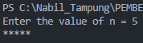
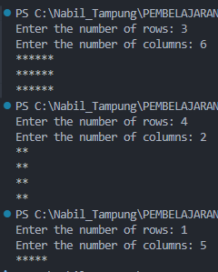
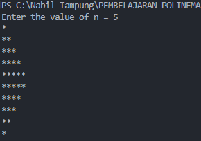
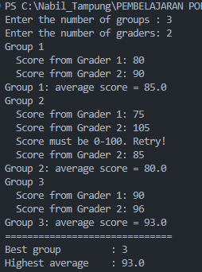
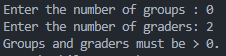
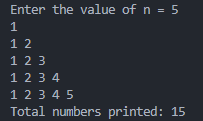
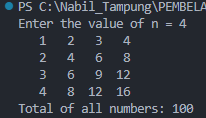
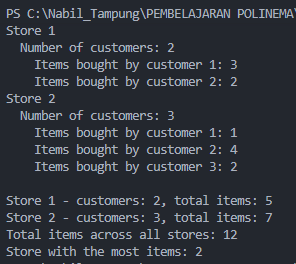

# Jobsheet 8: Loops 2 (Nested Loops)

**Course:** Programming Fundamentals 2026, Politeknik Negeri Malang
**Name:** Nabil
**Attendance No.:** 18
**Repository:** `Prakdaspro-jobsheet8`

---

## 1. Objectives

- Understand the concept of nested loops in algorithms.
- Understand the flow of nested loops.
- Recognize the syntax of nested loops.
- Apply nested loops to solve a simple case study.

## 2. Key Concepts

A nested loop is a loop placed inside the body of another loop. The outer loop runs once per round. For each round, the inner loop runs from start to finish.

| Item                   | Rule                                                                                                                          |
| ---------------------- | ----------------------------------------------------------------------------------------------------------------------------- |
| Total inner iterations | outer count × inner count                                                                                                     |
| Outer loop             | Controls rows (the shelf)                                                                                                     |
| Inner loop             | Controls columns (the locker on the shelf)                                                                                    |
| `print`                | Stays on the same line                                                                                                        |
| `println`              | Moves to a new line. Place it after the inner loop, inside the outer loop                                                     |
| Reset rule             | A variable that must start fresh for each outer round (a row counter, a row total) is declared or reset inside the outer loop |
| Persist rule           | A variable that tracks a result across all rounds (a grand total, a best value) is declared before the outer loop             |

Loop choice in this jobsheet:

- `for` fits a known number of repeats.
- `while` fits a condition checked before each round.
- `do-while` runs its body at least once, so it fits input validation.

---

## 3. Experiment 1: Review of Loops 1

**File:** [Star18.java](../2.1%20Experiment%201/Star18.java)

### Code

Program utama dapat dilihat di [Star18.java](../2.1%20Experiment%201/Star18.java).

### Output



### Answers

1. **`i = 0` with condition `i <= n`, n = 5:** The loop runs for i = 0, 1, 2, 3, 4, 5. That is **6** iterations, so the program prints 6 `*`. Starting one step earlier adds one extra round.

2. **Condition `i < n`, n = 5:** The loop runs for i = 1, 2, 3, 4. That is **4** iterations. The original condition includes i = 5, while `i < n` stops before it. The `<=` operator counts the boundary value and `<` does not.

3. **Prediction for n = 9:** The loop starts at 2 and adds 2 each round, so it prints `2 4 6 8 `. The next value, 10, is greater than 9 and ends the loop.

   Modified code for odd numbers up to n:

   ```java
   for (int i = 1; i <= n; i += 2) {
       System.out.print(i + " ");
   }
   ```

   For n = 9 the output is `1 3 5 7 9 `.

4. **`i--` with condition `i <= n`:** The counter starts at 1 and decreases (1, 0, -1, -2, ...). Every value stays below or equal to n, so the condition `i <= n` never becomes false. The program keeps printing `*`. In Java, an `int` that falls below its minimum wraps around to the maximum value, which ends the loop only after roughly 2.1 billion iterations. In practice the program does not finish in a reasonable time. Press `Ctrl + C` to stop it.

---

## 4. Experiment 2: Rectangle Star Pattern (Nested FOR)

**File:** [Rectangle18.java](../2.2%20Experiment%202/Rectangle18.java)

### Code

Program utama dapat dilihat di [Rectangle18.java](../2.2%20Experiment%202/Rectangle18.java).

### Output



Comparison: the first output is wide, the second is tall and narrow, and the third is a single line. The number of rows sets the height and the number of columns sets the width.

### Answers

1. `i` counts the current row and controls the outer loop. `j` counts the current column inside that row and controls the inner loop.

2. For rows = 4 and columns = 7:
   - The outer loop body runs **4** times.
   - The inner loop runs **7** times per row, so **4 × 7 = 28** times in total.
   - `print("*")` runs **28** times.

3. With the bounds swapped and rows = 3, columns = 6, the outer loop runs 6 times and the inner loop runs 3 times per round. The output has **6 rows of 3 stars** instead of 3 rows of 6 stars. The shape rotates by 90 degrees.

4. Without `System.out.println();` the cursor never moves to a new line. All stars appear side by side on one line. For rows = 3 and columns = 6, the output is 18 stars in a row: `******************`.

5. The change is in the `print` statement: replace `"*"` with `"#"`. Commit and push:

   ```
   git add Rectangle18.java
   git commit -m "Change rectangle character to #"
   git push
   ```

---

## 5. Experiment 3: Debugging a Star Triangle (Nested WHILE)

**File:** [Triangle18.java](../2.3%20Experiment%203/Triangle18.java)

### Starter code result

The starter code starts at `i = 0`, never calls `println`, and runs the outer loop for i = 0 to n.

| n   | Actual output                            | Target                   |
| --- | ---------------------------------------- | ------------------------ |
| 3   | `******` (6 stars on one line)           | 3 rows: `*`, `**`, `***` |
| 5   | `***************` (15 stars on one line) | 5 rows: `*` to `*****`   |

### Debug output (n = 5)

```
[i=0] [i=1] *[i=2] **[i=3] ***[i=4] ****[i=5] *****
```

**Answers for step 5:**

- **a.** The outer loop runs **6** times (i = 0, 1, 2, 3, 4, 5). The target is 5 rows, so the count is one too high.
- **b.** When `i = 0`, the inner condition `j < i` is `0 < 0`, which is false. The program prints **0** stars.
- **c.** The code has no `System.out.println();`, so the cursor never moves to a new line.

### Fix steps

- **6a.** After adding `System.out.println();` after the inner loop and before `i++`, the output shows 6 lines. The **first line is empty**, because the round for `i = 0` prints no stars.
- **6b.** Change the outer initialization from `int i = 0;` to `int i = 1;`. The loop now runs exactly n times with no empty line.

### Final code (triangle and inverted triangle)

Program utama dapat dilihat di [Triangle18.java](../2.3%20Experiment%203/Triangle18.java).

### Output (n = 5)



### Answers

1. **Mismatches in the initial output:** all stars sit on one line, the outer loop runs n + 1 times, and the first round prints nothing.
   **Fixes:** (1) add `System.out.println();` after the inner loop, and (2) start the outer counter at `i = 1`.

2. `i` is the current row number and also the number of stars that row must contain. `j` counts how many stars the program has printed in the current row.

   `j` must return to 0 at the start of every outer round because each row counts its stars from zero. Without the reset, `j` keeps the value from the previous row. If `j` were declared before the outer loop, row 1 would end with `j = 1`. Row 2 would start at `j = 1` and print only 1 star, and every later row would print 1 star as well. The output would be a column of single stars.

3. The inverted triangle needs three changes to the outer loop:
   - **Initialization:** `i = n` (start from the longest row).
   - **Condition:** `i >= 1` (stop after the row with one star).
   - **Update:** `i--` (shorten each row by one star).

---

## 6. Experiment 4: Case Study of Group Project Scores

**File:** [GroupScore18.java](../2.4%20Experiment%204/GroupScore18.java)

### Code

Program utama dapat dilihat di [GroupScore18.java](../2.4%20Experiment%204/GroupScore18.java).

### Output (3 groups, 2 graders, with the invalid score 105)



Invalid group count (groups = 0):



### Answers

1. `totalScore` holds the sum for one group. A new group needs a fresh sum, so the program resets it to 0 inside the outer loop. Without the reset, the scores of earlier groups would pile into later averages. `highestAverage` holds the best average across all groups. Resetting it for each group would erase the value the program needs for comparison, and every group would look like the best one.

2. The FOR loop body runs once per grader per group: **3 groups × 2 graders = 6** times.

3. If `totalScore` is `int`, the expression `totalScore / numGraders` divides two integers and drops the decimal part before the result goes into `averageScore`. Example: scores 80 and 85 give a total of 165. The division `165 / 2` gives `82`, so the program shows `82.0` instead of the correct `82.5`.

4. Scores start at 0, so an average can equal 0. With an initial value of 0, the test `averageScore > highestAverage` is `0 > 0`, which is false. Example: 1 group, 2 graders, both scores 0. The program would report `Best group : 0` and never record group 1. Starting at -1 guarantees that the first group always wins the first comparison.

5. The three loops:
   - **WHILE (outer):** processes each group, one at a time.
   - **FOR (middle):** reads the score of each grader, because the number of graders is known.
   - **DO-WHILE (inner):** asks for the score at least once and repeats while the score is outside 0 to 100.

---

## 7. Assignment 1: Nested Number Pattern

**File:** [Task118.java](../3.1%20Assigment%201/Task118.java)

### Code

Program utama dapat dilihat di [Task118.java](../3.1%20Assigment%201/Task118.java).

### Output (n = 5)



### Explanation

The outer loop selects the row `i`. The inner loop prints the numbers 1 to `i` in that row. The counter `totalPrinted` goes up by 1 for every number printed. The `if (j < i)` check adds a space between numbers and leaves no trailing space. The total for n rows is 1 + 2 + ... + n = n(n+1)/2, which gives 15 for n = 5.

---

## 8. Assignment 2: Multiplication Table

**File:** [Task218.java](../3.2%20Assigment%202/Task218.java)

### Code

Program utama dapat dilihat di [Task218.java](../3.2%20Assigment%202/Task218.java).

### Output (n = 4)



### Explanation

Each cell holds `row * col`. The format `%4d` prints every number right-aligned in a width of 4 characters, so single-digit and double-digit numbers line up. The variable `total` adds every product. For n = 4 the sum is 100, which matches (n(n+1)/2)² = 10² = 100.

---

## 9. Assignment 3: Sales Recap for Several Stores

**File:** [Task318.java](../3.3%20Assigment%203/Task318.java)

### Code

Program utama dapat dilihat di [Task318.java](../3.3%20Assigment%203/Task318.java).

### Output (example from the jobsheet)



### Edge case tests

| Case                   | Input idea                                    | Result                                                           |
| ---------------------- | --------------------------------------------- | ---------------------------------------------------------------- |
| Tie between stores     | 2 stores, each with 1 customer buying 4 items | `Store with the most items: 1` (smallest number wins)            |
| Store with 0 customers | Store 1 has 0 customers                       | Prints `customers: 0, total items: 0`, and the program continues |
| Negative value         | `-3` for items                                | Prints a retry message and asks again                            |

### Explanation

The outer FOR loop visits each store. The inner FOR loop visits each customer of that store and adds the items to `storeItems`. Because `storeItems` belongs to one store, it is declared inside the outer loop and starts at 0 for every store. The variables `totalAllItems`, `maxItems`, and `bestStore` sit before the outer loop because they carry results across stores. The program stores no individual data, only running totals. The comparison `storeItems > maxItems` uses a strict `>`, so the first store with the highest value stays the winner on ties. Starting `maxItems` at -1 lets a store with 0 items still become the best store when every store has 0 items.

---

## 10. Conclusion

- A nested loop runs the inner loop completely for every round of the outer loop.
- The outer loop sets the rows or groups and the inner loop sets the columns or members.
- Variables that restart for each round belong inside the outer loop. Variables that collect results across rounds belong before it.
- `do-while` suits input validation because the body always runs once.
- Debugging with a temporary print statement shows the loop counter values and exposes off-by-one errors quickly.
