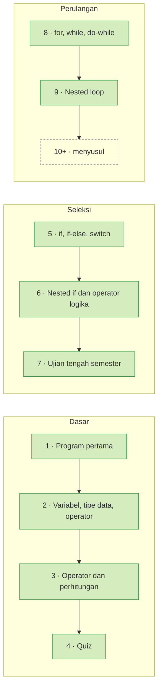

<div align="center">


<br>

[](#alur-belajar)
[](#sorotan)
[](#daftar-pertemuan)
[](#jalankan-sendiri)
[](https://github.com/search?q=repo%3Anxbiel%2FPembelajaran-Java-Semester-1+language%3AJava&type=code)

<br>


</div>

---

Kode ini lahir di kelas Dasar Pemrograman, Politeknik Negeri Malang, bersama Pak Imam. Tiap pertemuan punya satu folder berisi jobsheet, percobaan, dan tugas. Pertemuan 6, 8, dan 9 punya laporan lengkap dengan kode, hasil, dan analisis.

## Alur Belajar



## Sorotan

<table>
<tr>
<td width="50%" valign="top">

**🧩 Pertemuan 6 · Nested `if`**

Syarat ujian skripsi, absensi WiFi, akses lab, diskon toko buku.

[Folder](Pertemuan%20Keenam) · [Laporan Indonesia](Pertemuan%20Keenam/Jobsheet6_report_attendance18_ID.md) · [Laporan Inggris](Pertemuan%20Keenam/Jobsheet6_report_attendance18_EN.md)

</td>
<td width="50%" valign="top">

**🎬 Pertemuan 7 · Ujian tengah semester**

`CinemaGo` menghitung harga tiket bioskop. Proyek Arduino buzzer melengkapi ujian.

[Folder](Pertemuan%20Ke%20Tujuh)

</td>
</tr>
<tr>
<td width="50%" valign="top">

**🔁 Pertemuan 8 · `for`, `while`, `do-while`**

Nilai mahasiswa SIAKAD, pesanan kafe, tiket bioskop, biaya parkir.

[Folder](Pertemuan%20Kedelapan) · [Laporan](Pertemuan%20Kedelapan/Assigment%20Report/Report%20Jobsheet7%2018.md)

</td>
<td width="50%" valign="top">

**🪆 Pertemuan 9 · Nested loop**

Bintang, persegi panjang, segitiga naik dan turun, nilai kelompok, 3 tugas.

[Folder](Pertemuan%20Kesembilan) · [Laporan](Pertemuan%20Kesembilan/Assigment%20Report/Jobsheet%208%20report.md)

</td>
</tr>
</table>

## Daftar Pertemuan

<details open>
<summary><b>Sembilan pertemuan, dari <code>Hello World</code> sampai nested loop</b></summary>

<br>

| # | Topik | Yang dibuat |
| :---: | --- | --- |
| 1 | 👋 [Program pertama](Pertemuan%20Pertama) | `Latihan00` dan `MyFirstJava18` mencetak teks ke layar |
| 2 | 📦 [Variabel, tipe data, operator](Pertemuan%20Kedua) | Tugas 2.1 sampai 2.5, termasuk luas segitiga dan hitungan tabungan bank |
| 3 | ➕ [Operator dan perhitungan](Pertemuan%20Ketiga) | Luas persegi panjang, total pembayaran, total gaji, cicilan bulanan, biaya BBM |
| 4 | 📝 [Quiz](Pertemuan%20Keempat) | `QuizWeek4` menghitung konsumsi BBM motor di jalan kota, jalan raya, dan jalan pegunungan |
| 5 | 🔀 [Seleksi: `if`, `if-else`, `switch`](Pertemuan%20Kelima) | Cetak KRS, validasi SKS, mesin antrean akademik, tarif parkir |
| 6 | 🧩 [Nested `if` dan operator logika](Pertemuan%20Keenam) | Syarat ujian skripsi, absensi WiFi, akses lab, diskon toko buku |
| 7 | 🎬 [Ujian tengah semester](Pertemuan%20Ke%20Tujuh) | `CinemaGo` untuk harga tiket bioskop dan proyek Arduino buzzer |
| 8 | 🔁 [Perulangan 1: `for`, `while`, `do-while`](Pertemuan%20Kedelapan) | Nilai mahasiswa SIAKAD, pesanan kafe, tiket bioskop, biaya parkir |
| 9 | 🪆 [Perulangan 2: nested loop](Pertemuan%20Kesembilan) | Bintang, persegi panjang, segitiga, nilai kelompok, 3 tugas |

</details>

> [!TIP]
> Folder baru langsung tampil di daftar file GitHub dan menaikkan badge **Pertemuan** di atas. Alur belajar, sorotan, dan tabel butuh satu entri tambahan untuk tiap pertemuan baru.

> [!NOTE]
> Nomor jobsheet berbeda dari nomor pertemuan. Jobsheet 7 jatuh di Pertemuan 8, dan Jobsheet 8 di Pertemuan 9.

## Jalankan Sendiri

Kamu butuh JDK 21 atau lebih baru. Satu file `.java` jalan langsung tanpa compile terpisah:

```bash
java -version
cd "Pertemuan Kesembilan/2.1 Experiment 1"
java Star18.java
```

Di VS Code, pasang Extension Pack for Java, buka folder repo, lalu klik **Run** di atas method `main`. Hampir semua program meminta input lewat `Scanner`, jadi ketik jawabanmu di terminal setelah program mulai.

## Aturan Penamaan

- Nama file sama dengan nama `public class` di dalamnya. `Star18.java` berisi `public class Star18`.
- Akhiran `18` adalah nomor presensi penulis. Program di Pertemuan 3 memakai akhiran `Nabil`.

> [!IMPORTANT]
> Repo ini menyimpan pekerjaan belajar pribadi. Baca sebagai referensi, kerjakan tugasmu sendiri, dan ikuti aturan dosen pengampu.

<div align="center">

**M. Syailendra Nabil Destama** · [@nxbiel](https://github.com/nxbiel)


</div>
